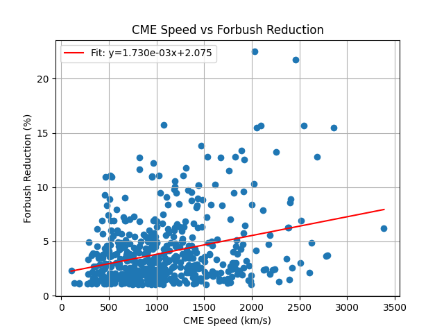
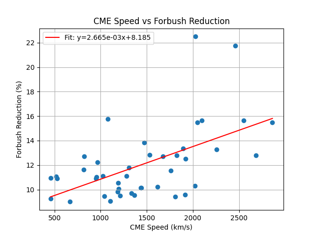

# CME Speed and Forbush Reduction

## Overview

I compared coronal mass ejection (CME) speeds with the drop in neutron-monitor counts around each event. I wanted to see how strongly faster CMEs were associated with larger Forbush reductions.

This repository contains the data I used, the data-manipulation programs, and the saved graphs and console output from the analysis.

## Methodology

The workflow pairs CME data from NASA's SOHO/LASCO catalogue with neutron counts from the Oulu station in Finland.

- `cleaner.py` filters the CME catalogue and extracts neutron-count windows from two days before each event through five days after it.
- `forbush.py` uses the first 48 entries in each event window to estimate the normal count rate, then finds the minimum in the remaining entries.
- The percentage reduction is calculated as `(normal rate - minimum rate) / normal rate × 100`.
- `main.py` matches the event dates to CME speeds, applies its reduction filter, fits a line, and calculates the correlation coefficient and count-based error estimates.

Only a portion of the event-window CSVs is included. The raw source files and the cleaning script are available for generating the remaining windows.

## Existing Results



*The saved scatter plot compares CME speed with the percentage reduction in neutron-monitor counts.*



*This second saved figure shows the stronger-event comparison. The event-selection threshold is set in `main.py`.*

[output.txt](output.txt) contains saved console output from an earlier run, including event counts and a correlation coefficient. The saved figures and log reflect the selections used when they were generated; the checked-in `main.py` currently filters reductions below 1% or above 99.9%.

## Repository Structure

| File or folder | Purpose |
| --- | --- |
| [data/RawCMEData.txt](data/RawCMEData.txt) | Source CME catalogue data |
| [data/CleanedCMEData.csv](data/CleanedCMEData.csv) | Filtered CME records |
| [data/](data/) | Annual neutron-count files and CME source data |
| [data/CMEdata/](data/CMEdata/) | Included neutron-count windows for individual CME dates |
| [scripts/cleaner.py](scripts/cleaner.py) | Filters CME records and generates event-window CSVs |
| [scripts/forbush.py](scripts/forbush.py) | Normal-rate, minimum-rate, reduction, and error calculations |
| [scripts/neutron_analysis.py](scripts/neutron_analysis.py) / [scripts/graphs.py](scripts/graphs.py) | Additional analysis and plotting scripts |
| [main.py](main.py) | Event matching, regression, correlation, and plotting |
| [graphs/](graphs/) | Saved comparison figures |
| [output.txt](output.txt) | Saved console output |

## Usage

Run the existing workflow from the repository root:

```bash
python -m pip install numpy pandas matplotlib
python scripts/cleaner.py
python main.py
```

The cleaning step writes the filtered catalogue and event-window CSVs. The analysis reads those windows and generates its graph. The original plotting path in `main.py` uses a Windows-style separator. These commands document the existing workflow; the saved figures can be inspected without running it.

## Data Sources

- [NASA SOHO/LASCO CME Catalogue](https://cdaw.gsfc.nasa.gov/CME_list/UNIVERSAL_ver2/text_ver/)
- [Oulu Cosmic Ray Station, University of Oulu / Sodankylä Geophysical Observatory](https://cosmicrays.oulu.fi/)
